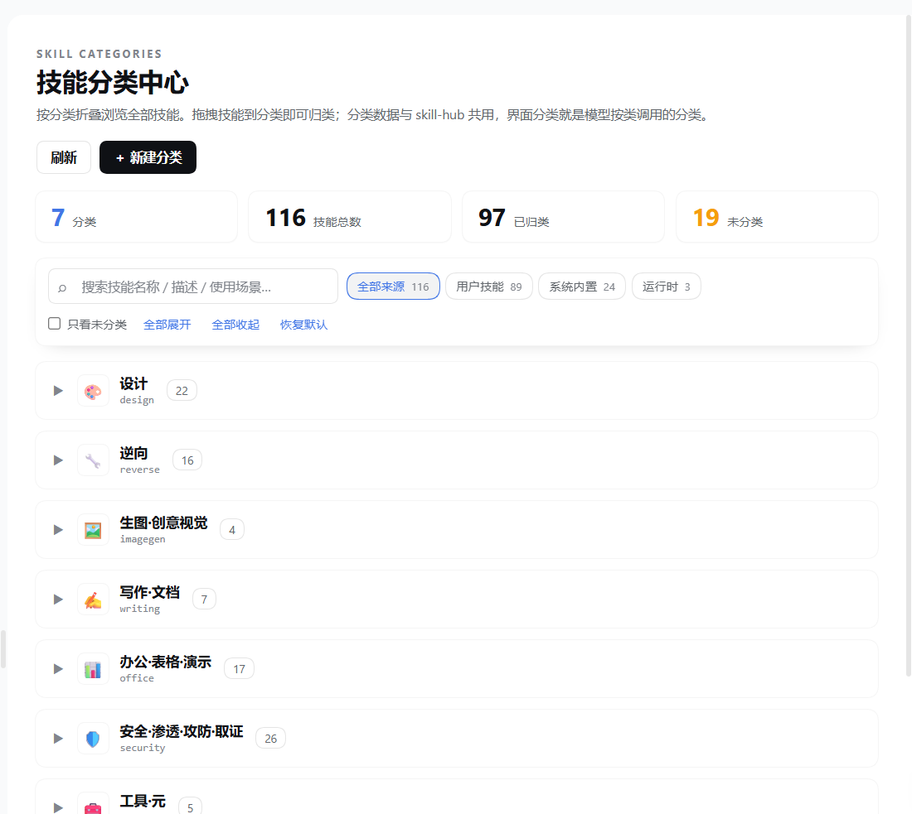

# DSH 技能分类中心



为 DSH Web 侧栏增加一个「技能分类」面板：把当前环境里的全部技能按 7 大类别折叠展示，支持搜索、来源筛选、拖拽归类、分类新建/重命名/删除，并把分类结果共享给 `skill-hub`。

## 1. 项目解决什么问题

DSH 的技能数量会随着插件和自定义技能不断增加。默认情况下，技能以「全部平铺列表」的形式存在，使用时会遇到三个问题：

- **模型看到的技能目录太长**：每个技能的 `name + description` 都会进入上下文。当前环境已经有 116 个技能，全量目录约 33,394 字符、估算 10,436 tokens；技能越多，每次调用前花在「选技能」上的上下文就越多。
- **人找不到技能**：侧栏没有按类别折叠的视图，技能一多只能靠搜索和记名字。
- **分类没有图形界面**：`skill-hub` 虽然维护了 7 类技能映射，但分类数据是 JSON，改分类要手改文件。

本插件把「技能分类」变成可操作的界面：用户可以像整理文件夹一样把技能拖进 7 个分类，分类保存到统一 JSON，并同步回 `skill-hub`。这样既方便人浏览，也能为「按类调用技能」提供稳定的分类索引，从而把交给模型的候选技能从「全量」收窄到「某一类」。

> 说明：本插件负责分类浏览与分类数据管理，不修改官方技能中心，也不自动改写 DSH 的系统提示；token 节省发生在「按分类检索/调用」这一层。

## 2. 主要功能

- **7 大分类折叠浏览**：设计 / 逆向 / 生图·创意视觉 / 写作·文档 / 办公·表格·演示 / 安全·渗透·攻防·取证 / 工具·元。
- **全量技能发现**：扫描用户技能目录 `~/.dsh/skills`、项目级 `.dsh/skills` 与 `.agents/skills`，再合并 DSH 内置与运行时技能；当前环境共 **116 个技能**（用户技能 89、系统内置 24、运行时 3）。
- **搜索与来源筛选**：按名称、描述、`whenToUse` 搜索；可按「全部 / 用户技能 / 系统内置 / 运行时」筛选；支持「只看未分类」。
- **拖拽归类**：把技能行拖到分类卡片即可换类；也可以从「移至」下拉框选择目标分类。每次操作立即保存。
- **分类管理**：新建分类（emoji 图标 + 唯一 key）、重命名、删除；删除分类后，其中的技能自动进入「未分类」。
- **双写分类数据**：自有 `~/.dsh/skill-categories.json` 为主；保存时同步 `~/.dsh/skills/skill-hub/skill-classes.json`，让界面分类继续作为 `skill-hub` 按类调用的分类索引。
- **零侵入**：不修改任何 `@deepseek-ai` 官方包；不编辑技能内容、不安装技能。

## 3. 安装方法

### 从本地目录安装（开发/当前环境）

要求：DSH Web 客户端，DSH `>= 0.2.1-rc.3`。

```powershell
plugin_manager install_bundle target=<你的插件目录>
```

安装后重载插件：

```powershell
plugin_manager set_plugin target=include:skill-categories enabled=false
plugin_manager set_plugin target=include:skill-categories enabled=true
```

如果只更新了 Client 端的 `client.js` / 样式，在 DSH 页面按 `Ctrl+R` 刷新渲染器即可。

### 从 GitHub Release 安装（发布后）

从 [v0.1.0 Release](https://github.com/kkqwq7/dsh-skill-categories/releases/tag/v0.1.0) 下载 `dsh-skill-categories-0.1.0.tgz`，然后在 DSH 中安装：

```text
plugin_manager install_bundle target=<下载后的 dsh-skill-categories-0.1.0.tgz 路径>
```

也可以直接把 GitHub Release 的 tarball 地址作为 `target`。具体安装入口以你当前 DSH 版本的插件管理器为准；插件本身不带安装器，也不会自动安装其他技能。

## 4. 使用方法

1. **打开面板**：在 DSH 左侧栏点击「技能分类」。
2. **浏览技能**：点击分类标题展开/收起；顶部统计卡显示分类数、技能总数、已归类、未分类。
3. **搜索与筛选**：在搜索框输入技能名称、描述或使用场景；按来源筛选；勾选「只看未分类」查看还没归类的技能。
4. **改变技能分类**：把技能行拖到目标分类，或在行尾「移至」下拉框选择分类。保存后立即写入 JSON。
5. **管理分类**：点击「+ 新建分类」填写分类名称、emoji 图标、唯一 key；分类行右侧支持重命名和删除。
6. **恢复默认**：点击「恢复默认」从 `skill-hub` 重新载入 7 类默认分类；当前自定义分类会被覆盖。
7. **验证落盘**：看面板底部显示的分类文件路径，或直接检查 `~/.dsh/skill-categories.json`。

### 数据文件

| 文件 | 格式 | 用途 |
| --- | --- | --- |
| `~/.dsh/skill-categories.json` | `version:1` + `classes` 数组 | 本插件的主分类文件 |
| `~/.dsh/skills/skill-hub/skill-classes.json` | `version:2` + `classes` 对象 | 与 `skill-hub` 共享的分类索引 |

`skill-categories.json` 形如：

```json
{
  "version": 1,
  "updated": "2026-11-18T13:00:00.000Z",
  "classes": [
    {
      "key": "design",
      "label": "设计",
      "icon": "🎨",
      "order": 1,
      "skills": ["animate", "brainstorming"]
    }
  ]
}
```

技能使用 frontmatter 中的真实注册名（不是文件夹名）。未出现在任何分类中的技能会自动显示在「未分类」。写入采用同目录临时文件 + rename 的原子写方式，避免写到一半损坏文件。

## 5. 示例

### 示例 A：把未分类技能拖进「设计」

当前 `review-animations` 处于「未分类」。在面板中把它拖到「设计」分类，保存后：

- `~/.dsh/skill-categories.json` 的 `design.skills` 会增加 `review-animations`；
- 「未分类」数量从 19 变成 18；
- `skill-hub/skill-classes.json` 同步更新，`skill-hub` 按「设计类」调用时即可看到它。

> 如果不想同步 `skill-hub`，可调用保存接口时传 `syncHub: false`。

### 示例 B：按「写作·文档」类收窄技能目录

当前环境 116 个技能，按名称 + 描述字符数、约 3.2 字符/token 估算：

| 范围 | 技能数 | 字符数 | 约 tokens |
| --- | ---: | ---: | ---: |
| 全量技能目录 | 116 | 33,394 | 10,436 |
| 「写作·文档」候选 | 7 | 2,420 | 756 |
| 差额 | 109 | 30,974 | 9,679（约 92.8%） |

「写作·文档」当前 7 个候选：`anti-defensive-writing`、`anti-sycophancy`、`docs-generator`、`humanizer-zh`、`lieflat-less-ai-tone`、`research-assistant`、`writing-guidelines`。

这只是「候选技能目录」的估算；如果按类再加载某个技能的正文（例如 `writing-guidelines` 的 `SKILL.md` 约 755 tokens），需要把正文本身另算。关键点是：**分类越准确，交给模型的候选越少，选技能的上下文成本越低**。

### 示例 C：用 HTTP API 检查与保存

```powershell
# 健康检查
Invoke-RestMethod http://127.0.0.1:<DSH_PORT>/api/dsh-skill-categories/health
```

返回：

```json
{
  "ok": true,
  "service": "skill-categories",
  "skills": 116,
  "classes": 7,
  "source": "categories"
}
```

```powershell
# 读取技能与分类
Invoke-RestMethod http://127.0.0.1:<DSH_PORT>/api/dsh-skill-categories/list

# 保存分类（classes 为完整数组；syncHub 可选）
Invoke-RestMethod http://127.0.0.1:<DSH_PORT>/api/dsh-skill-categories/save `
  -Method Post -ContentType 'application/json' `
  -Body '{"classes":[...],"syncHub":true}'

# 恢复默认 7 类
Invoke-RestMethod http://127.0.0.1:<DSH_PORT>/api/dsh-skill-categories/reset -Method Post
```

## 6. 架构

- **Host 端**：`index.js`
  - 注入 `webServer`、`skills`、`sessions`；
  - 自扫技能根并解析 `SKILL.md` frontmatter，再用 `ctx.skills.list()` 合并 bundled/runtime 技能；
  - 读写 `~/.dsh/skill-categories.json`，保存时回写 `skill-hub`；
  - 通过 `ctx.webServer.register` 暴露四条 exact 路由，全部只接受本机 loopback 请求。
- **Client 端**：`client.js`
  - 通过 `sidebar.panellist` + `main` 两个 slot 注册「技能分类」入口与页面；
  - 纯 React 渲染，所有文件操作走 `fetch` → Host 路由；
  - 样式用 `<style data-plugin-css>` 注入，基于 `--dsw-alias-*` 主题变量，自动适配明暗主题。

## 7. HTTP 路由

| 方法 | 路径 | 说明 |
| --- | --- | --- |
| GET | `/api/dsh-skill-categories/health` | 服务与技能数量健康检查 |
| GET | `/api/dsh-skill-categories/list` | 返回技能、分类与统计 |
| POST | `/api/dsh-skill-categories/save` | 保存 `{ classes, syncHub? }` |
| POST | `/api/dsh-skill-categories/reset` | 从 skill-hub 重新载入默认分类 |

所有路由只接受本机 loopback 请求。

## 8. 兼容性

- DSH `>= 0.2.1-rc.3`，Web 客户端；
- 已在 DSH `0.2.1-rc.5` / Windows 桌面端验证；
- Windows 下依赖本机 loopback 路由，不支持跨机器访问；
- 分类文件中的技能使用 frontmatter `name`，不是文件夹名。

## 9. 开发检查

```powershell
node --check index.js
node --check client.js
```

## License

MIT
